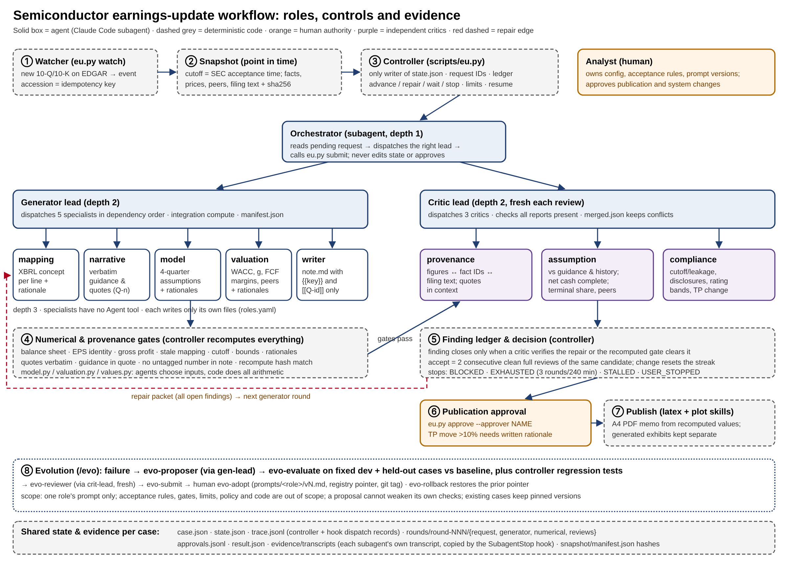

# Design note: a long-running agent workflow for semiconductor earnings updates

*Annotated diagram: [`architecture.svg`](architecture.svg). Numbers ①–⑧ below refer to it.*

## 1. The task

**User and current process.** A sell-side analyst covers seven AI-semiconductor companies
(NVDA, AMD, INTC, AVGO, MRVL, MU, AMAT), with seven more (LRCX, KLAC, SNPS, CDNS, ALAB,
CRDO, MPWR) used only as valuation comparables. After every 10-Q or 10-K the analyst
reads the filing and the earnings release, updates a spreadsheet model, revisits the
valuation and rewrites a short note. That takes hours per company. The seven fiscal calendars
differ (NVDA's year ends in late January, MU's in late August, AMAT's in late October), so
filings arrive in most months of the year. The usual errors are copying a wrong number,
mixing fiscal and calendar quarters, using a discontinued XBRL line, and leaving out
something the market did not know on the report date.

**What this project actually ran.** The workflow is built for the full coverage list, but
because of time, research cases were run for three companies: NVDA (FY2027 Q2 10-Q), AMD
(Q3 2026 10-Q) and MU (FY2026 10-K). INTC, AVGO, MRVL and AMAT are configured and watched,
but have no case. The comparables appear only as peer data in each snapshot.

**Stages and dependencies.** trigger → point-in-time snapshot → XBRL mapping and
guidance extraction (independent of each other) → forecast assumptions (need both) →
valuation inputs (need the forecast) → note (needs everything) → numerical gates →
independent review → repair loop → research acceptance → human publication approval → PDF.

**Triggers.** `eu.py watch` lists new 10-Q/10-K filings for the coverage list. The
accession number is the event ID, so a repeated watch never opens a duplicate case. The
watcher can run on a schedule (a cloud scheduled task or cron); it is pure Python and needs
no model. `--as-of` replays history. In this project the NVDA and AMD cases were opened
directly by accession (`/start <TICKER> <accession>`); the MU case followed a `watch` run,
recorded in `events/events.jsonl`.

**Inputs, permitted sources, cutoff.** SEC EDGAR (submissions, companyfacts XBRL, filing
documents) and one daily-price endpoint. `config/project.yaml` lists the permitted hosts and
`src/aicfinal/http.py` enforces them in code. The cloud environment's network allowlist
enforces them again. A case's cutoff is the SEC acceptance time of the filing that opened it.
Facts come only from filings accepted at or before the cutoff, and prices only from
sessions that closed at or before it. A restatement filed later is invisible to an earlier
case (`tests/test_xbrl.py`, `tests/test_leakage.py`).

**Work products and acceptance.** For each case: `mapping.json`, `narrative.json`,
`assumptions.json`, `valuation_inputs.json`, a note in which every figure is a code-generated
`{{key}}` and every quotation a verbatim `[[Q-id]]`, the recomputed history, forecast and
valuation, the review record, an approval record and an A4 PDF. The fixed acceptance criteria
are in [`references/acceptance.md`](../references/acceptance.md).

**Why a persistent workflow rather than a script.** The work recurs all year on external
triggers. Each quarter builds on the last published target price, which matters because a
large move needs a written rationale. Review is iterative and carries open findings across
rounds. Publication waits for a person. Runs are long enough to be interrupted. The
system's own prompts must be improved and rolled back without disturbing cases in flight.

## 2. Architecture

### Roles and handoffs

| Role | Decides | Tools / writes | Input → output |
|---|---|---|---|
| **Controller** (`scripts/eu.py`, Python) | every state transition; recomputes all numbers | only writer of `state.json`, `trace.jsonl`, `result.json` | submissions → advance / repair / wait / stop |
| **Orchestrator** (subagent) | which lead to dispatch for the pending request | Agent, Bash, Read; `decision_note.md` | request → lead dispatch → `eu.py submit` |
| **Generator lead** | dispatch order, which specialist owns each finding, integration | Agent; `manifest.json` | request + repair packet → candidate |
| gen-mapping | XBRL concept per model line | `mapping.json` | facts → mapping with rationales |
| gen-narrative | which statements matter; verbatim quotes and guidance | `narrative.json` | filing text → quotes `Q-n` |
| gen-model | next-four-quarter assumptions | `assumptions.json` | history + guidance → assumptions |
| gen-valuation | WACC, terminal growth, FCF margins, peers, weights | `valuation_inputs.json` | forecast → inputs |
| gen-writer | the prose | `note.md` | `values.json` + quotes → note |
| **Critic lead** | runs a fresh full review; keeps conflicting findings | Agent; `merged.json` | candidate → merged findings |
| crit-provenance / crit-assumption / crit-compliance | findings and verdicts in their area | own report only | candidate + recomputation → findings |
| evo-proposer / evo-reviewer | a scoped prompt change / its review | change folder only | failure → candidate prompt → review |
| **Analyst (human)** | publication, adoption of system changes, policy | `eu.py approve`, `evo-adopt` | evidence → decision |

**Why this split.** Each role differs from the others in context, permissions or the need to
be independent. Mapping concepts, reading text, forecasting, valuing and writing are separate
judgments, and each produces its own artifact, so a repair packet can go to the specialist
that owns the finding. Critics run in fresh contexts, see only evidence (never the
generator's reasoning) and cannot edit the candidate. All arithmetic is deterministic code
(`model.py`, `valuation.py`, `values.py`). Agents choose inputs and justify them. The writer
cannot type a number: the provenance gate rejects any digit not supplied by code or by a quote.

**Agent decisions vs. harness control.** Agents decide *content*: mappings, assumptions,
wording, findings. The controller decides *process*. It checks request IDs and report
completeness, compares hook-recorded dispatches with the allowlist in `references/roles.yaml`,
reruns the pipeline and the gates, keeps the ledger, and chooses the route. A PreToolUse hook
refuses direct edits to control files, and during a run it also refuses edits to policy files.

### Long-running operation

* **Defects during a run (process changed on 2026-11-15).** Until then a run session that met a
  code defect recorded it, put the case on hold and stopped; a new session resumed after the fix.
  The first 10-K case (MU) stopped twice this way. At the owner's request the coordinating
  session now runs the case itself and repairs the defect in place: exact error in the case notes,
  fix plus regression test, full test suite, an incidents entry and a separate commit, then
  `release` and `resume` of the same case. Acceptance criteria, policies, prompts and limits are
  never changed to let a case pass; after three repairs in one case the owner decides. MU then ran
  to publication with one more repair (the release accession, incidents #15).
* **State and checkpoints.** `cases/<ticker>-<accession>/` holds `case.json` (pinned prompt
  versions, limits, cutoff), `state.json` (status, round, review, pending request, clean
  streak, ledger, artifact hashes), `trace.jsonl` (controller transitions plus hook dispatch
  records) and `rounds/round-NNN/{request, generator, numerical, reviews}`. State is
  written atomically at every transition.
* **Dependencies.** The generator lead dispatches in dependency order. The controller does
  not advance until all five reports and the manifest exist for the current request ID.
* **Retries.** HTTP: four attempts with backoff, for temporary status codes only. Agents: a
  lead re-dispatches a missing specialist once. Controller: a first invalid submission stays
  at the same step; the second makes the case **BLOCKED**.
* **Stop and escalate.** **EXHAUSTED** after 3 generator rounds or 240 minutes (exhaustion
  never implies acceptance), **STALLED** when the same blocking findings survive two
  consecutive repairs, **USER_STOPPED** on request, **REJECTED** by the approver. Each reason
  is recorded in `result.json`.
* **Resume without repeating work.** `eu.py resume` first re-verifies the snapshot hashes
  and every verified round's artifact hashes. If verified evidence changed, it stops. Otherwise
  it names the single next action: for a pending request, only the specialists whose reports
  are missing are re-dispatched under the *same* request ID, and a terminal case returns its
  saved result. Opening an existing case returns it unchanged, and snapshots are never rebuilt
  once their hashes verify.
* **Who resumes.** Saved state guarantees that work *can* resume, not that anyone *will*. In
  the AMD run a session sat idle for about 50 minutes after an interruption (see
  [`incidents.md`](incidents.md) #8). `eu.py watchdog --minutes N` reports cases with an
  outstanding request and no activity for N minutes (exit code 1), for a scheduled check. A Stop
  hook keeps a run session from ending its turn while its case silently waits, and
  `eu.py hold --reason` makes an intentional pause explicit and visible.
* **Limits.** Per case: 3 rounds, 2 invalid submissions per step, 12 dispatches per round
  (cost proxy; checked from the hook log), 240 minutes. Per role: `maxTurns` and a minimal
  tool list in each agent file (specialists have no Agent tool, critics write only their
  report). Network: the permitted hosts only. No role can pay, trade or send messages.

### Verification and improvement

* **Independent checks.** (a) Numerical and provenance gates that the controller runs
  itself, on its own recomputation; a generator-saved file that differs from it fails.
  (b) Three critics in fresh contexts per review, with stable finding IDs. A finding closes
  only when a critic verifies the repaired output or the recomputed gate no longer reports it;
  omitting a finding does not close it.
* **Bounded revision loop.** Gate or critic findings produce a repair packet with all open
  findings, at most 3 rounds. Acceptance needs **two consecutive clean full reviews of the same
  candidate**, and any change to the candidate resets the count.
* **Human approval before consequential actions.** Research acceptance stops at
  `AWAITING_APPROVAL`. Publication needs `eu.py approve --approver <name>`, recorded in
  `approvals.jsonl`. A target-price move above 10% needs a written rationale. Adopting a
  system change needs `evo-adopt --approver <name>`.
* **Testing a change against a fixed baseline (Evolution, ⑧).** `evo-prepare` records the
  failure, the parent prompt version, the acceptance checks (set by the human, so the proposal
  cannot weaken them) and the fixed development and held-out cases. `evo-proposer` writes a
  candidate prompt for one role only. The target role is run with the baseline and the
  candidate prompt on every evaluation case. `evo-evaluate` compares both arms with
  deterministic checks, flags regressions (baseline passes, candidate fails) and runs the
  controller regression suite. `evo-reviewer` checks scope and evidence in a fresh context.
  Only then can the human adopt it.
* **Version, rollback.** Adoption copies the candidate to `prompts/<role>/vN.md`, moves the
  registry pointer, and records the approver, the evaluation hash and a suggested tag
  (`prompt-<role>-vN`) in the registry. The person who adopts the change commits and tags it.
  Existing cases keep the versions pinned in `case.json`. `evo-rollback` restores the prior
  pointer and keeps both versions.
* **Leakage prevention.** Cutoff by SEC acceptance time; price observability by session
  close; restatements resolved per cutoff; a perturbation test (lecture slide 44) that alters
  later filings, later restatements and later prices and requires identical outputs, with a
  control showing the same perturbation *is* visible after the cutoff; and a compliance critic
  that checks the prose for post-cutoff knowledge.

## 3. Platform findings that shaped the design

1. **Nested dispatch is off by default in the cloud runtime.** It sets
   `CLAUDE_CODE_MAX_SUBAGENT_SPAWN_DEPTH=1`, so the first live run stopped at
   `GENERATOR_PENDING`: the orchestrator had no Agent tool. The controller held the case
   safely, and nothing ran out of order. Project settings now set the depth to 3, a probe
   session confirmed that a subagent can dispatch a child, and the case was resumed from its
   pending request (see `cases/RUN_NOTES.md`).
2. **Subagent allowlists are not enforced inside subagent definitions.** `Agent(type, …)`
   lists are honoured only for a main-thread agent. The controller therefore enforces
   `references/roles.yaml` against the dispatch log written by the SubagentStart/Stop hook.
   A dispatch outside the list, a missing required role or more than 12 dispatches makes the
   submission invalid. The hook payload carries `agent_type`, `agent_id` and, on stop,
   `agent_transcript_path`. The hook copies each subagent's transcript into the case's
   `evidence/transcripts/`, which also shows that the contexts were separate.
3. **A newly created `.claude/agents/` directory is not picked up by a running session.**
   Live runs therefore start in a fresh session on the committed branch.
4. **A catalog-only snapshot hid data the agents needed.** In the NVDA run, gen-mapping
   rejected the stale `MarketableSecuritiesCurrent` (last value 2025-10-26) and noted that the
   balance sheet now reports marketable debt and equity securities separately. Those concepts
   (`DebtSecuritiesCurrent`, `EquitySecuritiesFvNi`) were not in the snapshot, so net cash
   left them out. The fix is a code change, not a prompt change: snapshots now keep every
   concept the company reports, and a line may map to a list of concepts summed per period.
   Cases opened before the fix keep their original snapshot. A changed input version means a
   new case, as in lecture slide 26.

## 4. Borrowed from industry, and what was added

From Harvey's Legal Work Orchestration: a reusable case template with phases, tasks and
review gates, tasks owned by agents or by named people, and a status board
(`eu.py status` → `STATUS.md`, and `eu.py dashboard` → `dashboard.html`). From Rogo: event-driven agents with idempotent triggers,
data separation by cutoff, and per-case limits with model routing (`model:` per agent:
lighter models for mapping and extraction). Their public material does not show independent
verification, provenance gates or versioned, reversible system changes; those come from the
course's QT framework and are the core of this design.

## 5. Evidence from the live runs

| Case | Outcome | What it demonstrates |
|---|---|---|
| `cases/NVDA-0001045810-26-000075` (r1) | STALLED after 2 rounds | Independent critic caught net cash missing about $77bn of securities (asm-001). Specialists reported it as unresolvable in code rather than inventing a figure; the bounded loop stopped and escalated. Also: first run blocked by the nesting limit and resumed from its pending request. |
| `cases/NVDA-0001045810-26-000075-r2` | **PUBLISHED**, TP $186, Underperform | Case revision for a changed input version; two consecutive clean reviews (6/6 critic passes); delegated, recorded approval; A4 PDF in `report/`. |
| `docs/verification/stop_hook.md` | PASS | Live Stop-hook test: a run session that tried to end its turn with its case pending was blocked, recorded a hold, and was then no longer listed by the watchdog. |
| `cases/AMD-0000002488-26-000191-r2` | **PUBLISHED**, TP $297, Underperform | Revision for the gate defect. Three rounds: critics caught an unsupported tax-benefit claim (prov-001) and undisclosed customer-warrant dilution of up to 320 million shares (asm-002), both repaired and verified; then two clean reviews and delegated approval. |
| `cases/MU-0000723125-26-000023` | **PUBLISHED**, TP $1,102, Neutral | First 10-K case (53-week year, 14-week derived Q4). It exposed three code defects the 10-Q cases could not (10-K Q4 has no diluted shares or EPS; per-share guidance scaled to billions; release accession not a code value). Two stops led the owner to change the process: defects are now repaired in place and the same case continues (incidents #12, #14, #15). Then two rounds: the critics caught net cash missing $30.0bn of long-term investments (asm-001), the release cited as part of the 10-K (cmp-001) and a broken guidance table (prov-001); all repaired, two clean reviews, delegated approval. Four minor findings stay open and are printed in the PDF. |
| `cases/AMD-0000002488-26-000191` | STALLED (false stop) | Deliberate interruption: `resume` kept 3 completed reports and re-dispatched only 2. Then a gate defect (fixed in 6fddfe2) produced a false stall, recorded in `docs/incidents.md` #7. |

`dashboard.html` (generated by `eu.py dashboard` from the case state, ledgers, recomputes, evolution
folders and registers) shows these results on one offline page.

All interruptions (including a deliberate one, a quota stop and an owner pause) are listed with their resume outcome in [`interruptions.md`](interruptions.md), and all rejections in [`rejections.md`](rejections.md).

Every case keeps its snapshot hashes, request/round files, controller and hook trace, critic
reports, and each subagent's transcript under `evidence/transcripts/`. `docs/incidents.md`
lists the problems met during the build and runs, with timelines and fixes. **Diagnosis before a change** ([`evolution/diagnosis-2026-11-15.md`](../evolution/diagnosis-2026-11-15.md)):
after change-001 was rejected, the finding ledgers of all cases were reviewed for recurring
failures. The review found one code bug (the peer calendar label, fixed directly) and one
prompt-level failure with a code-side gap (the writer spells quantities in words, which the
digit-based provenance gate cannot see). The second became change-002. A third pattern was
deferred because no deterministic check can capture it.

**Evolution change-003 (`evolution/changes/change-003`, ADOPTED as gen-writer v3):** the same
rule as change-002, re-evaluated so that the failure condition is kept. `evo-prepare` now withholds
the code-supplied rating-band and date values from the frozen inputs (`--withhold-key`), runs two
samples per arm (`--samples 2`) and passes only if the baseline reproduces the failure
(`--require-baseline-failure`). Result: baseline v2 failed 6/6 samples (it wrote "fifteen percent",
"minus ten percent"), the candidate passed 6/6, and a fresh reviewer recommended adoption with two
minor findings. The owner adopted it. A post-adoption check (review finding evo-003) ran v3 with
the keys present on NVDA r2 and the held-out AMD case: no spelled quantities, all five disclosure
keys used, no provenance findings. Cases opened earlier keep their pinned version.

**Evolution change-002 (`evolution/changes/change-002`, REJECTED):** a gen-writer rule against
spelled-out quantities. Rejected for the same reason as change-001: the code prerequisites had
already been applied to the evaluation inputs, so baseline v2 also passed. The coordinator's
evaluation design removed the failure condition before testing the prompt; the lesson is recorded
in the diagnosis file. The review also traced a prompt-level cause ("Spell out ordinal words." in
v2) and a gap in the check (fractions).

**Evolution (`evolution/changes/change-001`, REJECTED):**
the run proposed a gen-writer prompt edit so that the Disclosures would cite the trigger
accession, the cutoff and the price date. It then evaluated baseline (v2) against the candidate
on two development cases and one held-out case. Both arms passed every check, so the evaluation
could not tell them apart. A fresh evo-reviewer rejected the change for three reasons. The code
change that supplies the three values (commit 220c535) had already removed the cause. The
recorded failure had been mislabeled by the coordinator (it reused the ID cmp-001 for a different
issue). The scope and regression checks passed. Rollback is covered by
`tests/test_evolution.py`; it was not needed live.

## 6. Limitations

* **Low-conviction ratings driven by a conservative DCF.** All three published ratings come
  mostly from the DCF leg, and the two valuation methods disagree widely:

  | Case | DCF / share | Peer EV/Sales / share | Blended TP | Last close | Upside |
  |---|---|---|---|---|---|
  | NVDA r2 | $141.68 | $289.88 | $186 | $209.66 | -11.3% |
  | AMD r2 | $195.37 | $450.35 | $297 | $483.90 | -38.6% |
  | MU | $862.83 | $1,818.58 | $1,102 | $1,035.84 | +6.4% |

  The DCF uses a five-year explicit horizon. Growth fades fast (AMD: 25% to 8% in years 2-5,
  against 45% year-on-year growth in the quarter), FCF margins are anchored on history, and there
  is one scenario. At the cutoff the market priced AMD at about 50x next-twelve-month EPS, the
  target at about 30x. The critics check that each assumption is justified and plausible, not that
  the conclusion matches the market, so both notes passed. The workflow has no rule that forces
  extra scrutiny when the target sits far from the price or the methods diverge (only a target
  move of more than 10% against the last published note needs a written rationale). It also has
  no reverse-DCF check of the growth the price implies. The ratings are therefore
  policy-consistent but low-conviction. A production version would need scenario analysis, a
  longer explicit horizon, and a rule requiring a stated conviction level and the market-implied
  growth when |upside| > 30% or the methods differ by more than 2x.
* **Coverage actually exercised.** Cases were run for NVDA, AMD and MU only. INTC, AVGO, MRVL
  and AMAT are configured but untested; their XBRL mappings and fiscal calendars have not been
  through a live case. MU's 10-K exposed a defect that the 10-Q cases could not (incidents #12),
  so each untested issuer may need similar fixes.
* Prices come from an unofficial endpoint and are split-adjusted by the provider. A
  production system needs a licensed, point-in-time price source.
* Peer multiples are trailing (TTM). No consensus estimates are used, because they are paid
  data.
* XBRL coverage varies by company. Lines a company stops reporting are flagged as stale
  rather than imputed.
* The workflow publishes research only. It has no order or portfolio authority, and research
  acceptance is not a trading signal.
